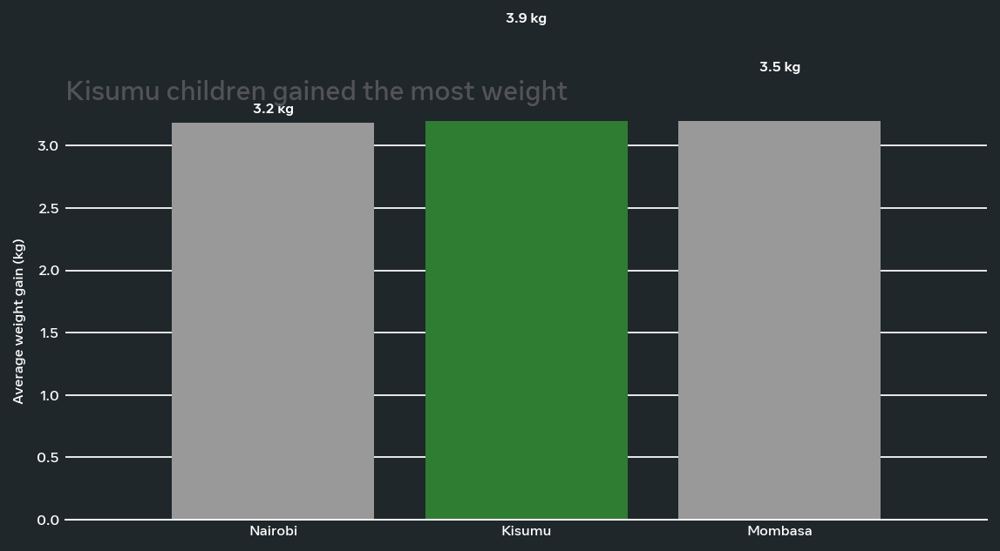
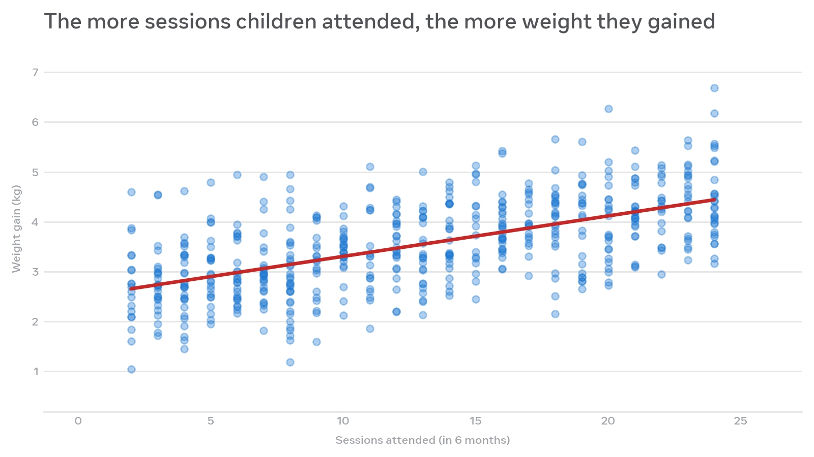
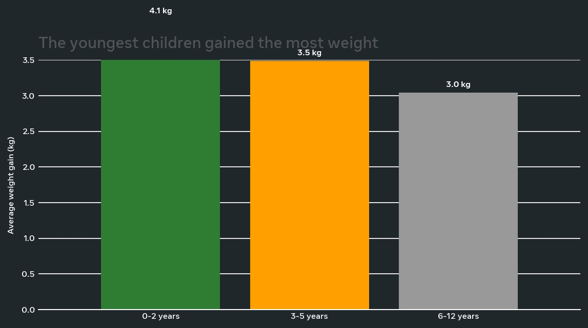

# Nairobi Nutrition Program - Data Storytelling

**By Owasa Olang | 6-Month Outcomes for Donor Meeting**

We followed 540 children in Nairobi, Kisumu and Mombasa for 6 months.
The donor is not a data person, so we tell the story with 3 charts and 3 plain headlines.

## Dataset
Columns: county, age_group, weight_gain_kg, sessions_attended, months_in_program
File: nutrition_data.csv

## Finding 1: Which county performed best?
### Headline: Kisumu children gained the most weight
Chart: chart1_county.png (Bar Chart)
What it means: Kisumu is doing something right. Nairobi is behind.
We should learn from Kisumu and copy it in Nairobi.
Detail: Kisumu 3.9 kg, Mombasa 3.5 kg, Nairobi 3.2 kg

## Finding 2: Does attendance matter?
### Headline: The more sessions children attended, the more weight they gained
Chart: chart2_attendance.png (Scatter Chart with Trend Line)
What it means: Showing up matters. Children who came more often grew more.
If we help more families attend regularly, more children will improve.

## Finding 3: Age group differences?
### Headline: The youngest children gained the most weight
Chart: chart3_age.png (Bar Chart)
What it means: The program works best for babies under two.
Older children gained less and may need different food or support.
Detail: 0-2 years 4.1 kg, 3-5 years 3.5 kg, 6-12 years 3.0 kg

## 5-Minute Talk
Good morning. In the last six months we followed 540 children in Nairobi, Kisumu and Mombasa.
First, Kisumu children gained the most weight. Nairobi is behind.
Second, the more sessions children attended, the more weight they gained.
Third, the youngest children gained the most weight.
So please help us get more children to attend regularly, share what works in Kisumu, and give extra support to older children. Thank you.

## Questions I Cannot Answer From This Data
1. Did the children stay healthy after the program ended? - We only have 6 months, no follow-up.
2. Why is Kisumu doing better - staff, food, or families? - Our data shows what happened, not why.
3. How much did each county spend per child? - We have no cost data.

## Pricing Note
For a six-month program analysis for an NGO, I would charge KES 75,000 - KES 120,000 (approx. $580 - $930).
Includes: cleaning data, 3 donor-friendly charts, 3 plain-language headlines, 1-page summary, and 10-minute presentation deck.
Why: NGOs have small budgets, but the work is 2-3 days. I charge for the story, not just the charts.
